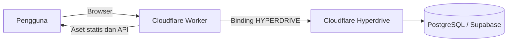

# Lloyd License Portal

<div align="center">

### Kelola lisensi dan jaringan akun Lloyd dari satu tempat.

Portal web untuk mengelola nomor bot, akun Partner/Reseller, dan akses LloydAI
dengan autentikasi aman serta backend Cloudflare Workers.

[Buka portal](https://lloydai-db.my.id/)


</div>

---

## Daftar isi

- [Tentang proyek](#tentang-proyek)
- [Fitur](#fitur)
- [Teknologi](#teknologi)
- [Arsitektur](#arsitektur)
- [Struktur akses](#struktur-akses)
- [Menjalankan secara lokal](#menjalankan-secara-lokal)
- [Deploy ke Cloudflare](#deploy-ke-cloudflare)
- [API](#api)
- [Pengembangan dan pengujian](#pengembangan-dan-pengujian)
- [Keamanan](#keamanan)

## Tentang proyek

Lloyd License Portal adalah portal administrasi terpisah dari bot LloydAI.
Frontend disajikan sebagai aset statis, sementara Cloudflare Worker menangani
API dan autentikasi. Database PostgreSQL diakses melalui Cloudflare Hyperdrive
untuk deployment, atau koneksi lokal untuk pengembangan dan migrasi.

**Portal live:** [lloydai-db.my.id](https://lloydai-db.my.id/)

## Fitur

- **Manajemen lisensi** — daftarkan nomor WhatsApp dalam format internasional,
  cari dan filter data, ubah status, hapus lisensi, dan ekspor CSV.
- **Jaringan akun** — Owner dan Partner mengelola akun sesuai hierarki akses.
- **Profil mandiri** — semua role dapat mengganti username, email, dan password.
  Username bersifat unik; password minimal 8 karakter.
- **Pengumuman portal** — Owner dapat menerbitkan, mengganti, atau menghapus
  pengumuman yang muncul kepada pengguna saat login.
- **Password script bersama** — Owner dapat mengatur password script; server
  hanya menyimpan hash bcrypt.
- **Dua tema tampilan** — pilih tema Cerah atau Gelap dari Pengaturan. Preferensi
  disimpan di perangkat yang sedang digunakan.
- **Tampilan responsif** — layout portal, navigasi, dan dialog mendukung layar
  desktop maupun ponsel.
- **Endpoint verifikasi bot** — verifikasi password, nomor lisensi, dan status
  lisensi dengan challenge serta token bertanda tangan.

## Teknologi

| Bagian | Teknologi |
|---|---|
| Frontend | HTML, CSS, JavaScript |
| API | Cloudflare Workers, Hono |
| Database | PostgreSQL, Supabase, Cloudflare Hyperdrive |
| Autentikasi | JWT, cookie HttpOnly, CSRF token, bcrypt |
| Pengujian | Node.js test runner |

## Arsitektur



## Struktur akses

| Role | Hak akses utama |
|---|---|
| **Owner** | Mengelola akun Partner/Reseller, lisensi, pengumuman, dan password script |
| **Partner** | Membuat akun Reseller dalam jaringan dan mengelola lisensi sesuai akses |
| **Reseller** | Mendaftarkan nomor serta mengelola lisensi miliknya |

Setiap akun dapat mengubah profilnya sendiri. Hak akses dan kepemilikan data
diverifikasi di server, bukan hanya disembunyikan dari tampilan.

## Menjalankan secara lokal

### Prasyarat

- Node.js **20 atau lebih baru**
- npm
- Database PostgreSQL (Supabase direkomendasikan untuk konfigurasi yang sama
  dengan produksi)

### 1. Pasang dependency

```powershell
npm install
```

### 2. Siapkan variabel lingkungan

Buat file `.env` di root proyek untuk migrasi dan backend Node lokal:

```dotenv
DATABASE_URL=<connection-string-postgresql>
PGSSLMODE=require
SESSION_SECRET=GANTI_DENGAN_SECRET_ACAK_MINIMAL_32_KARAKTER
```

Buat file `.dev.vars` untuk Cloudflare Worker lokal:

```dotenv
SESSION_SECRET=GANTI_DENGAN_SECRET_LOKAL_MINIMAL_32_KARAKTER
```

Gunakan secret berbeda untuk lokal dan produksi. File `.env` dan `.dev.vars`
diabaikan Git; jangan unggah, tempel ke issue, atau masukkan nilainya ke kode.

### 3. Terapkan migrasi database

```powershell
npm run db:migrate
```

Migrasi berjalan berdasarkan urutan nama file di `server/migrations/`. Jalankan
semua migrasi yang tersedia sebelum memakai portal.

### 4. Buat Owner pertama

`owner:create` membuat Owner pertama dan meminta password secara tersembunyi.
Tentukan email melalui environment variable:

```powershell
$env:OWNER_EMAIL = "owner@contoh.id"
npm run owner:create
Remove-Item Env:OWNER_EMAIL
```

Pilih password unik dan simpan di password manager.

### 5. Jalankan Worker lokal

```powershell
npm run dev:worker
```

Wrangler menyiapkan aset frontend sebelum Worker lokal dimulai.

Alternatifnya, backend Node lokal dapat dijalankan dengan:

```powershell
npm run dev
```

## Deploy ke Cloudflare

### Siapkan database dan Hyperdrive

1. Buat database PostgreSQL dan jalankan migrasi dari mesin admin dengan
   `DATABASE_URL` di `.env`.
2. Buat binding Hyperdrive pada akun Cloudflare yang terhubung ke database.
3. Masukkan ID Hyperdrive ke bagian `hyperdrive` pada `wrangler.jsonc`.
   Binding `HYPERDRIVE` dan custom domain `lloydai-db.my.id` sudah didefinisikan
   pada konfigurasi proyek.
4. Buat secret produksi. Wrangler meminta nilainya secara interaktif:

   ```powershell
   npx wrangler secret put SESSION_SECRET
   ```

   Gunakan secret acak minimal 32 karakter yang berbeda dari secret lokal.
5. Pastikan akun Cloudflare memiliki akses ke Worker, domain, dan Hyperdrive,
   lalu deploy:

   ```powershell
   npm run deploy
   ```

Perintah deploy menjalankan build aset terlebih dahulu, kemudian mengunggah
Worker dan isi `public/`. Jangan memasukkan connection string atau secret ke
`wrangler.jsonc`, frontend, maupun repository Git.

> Untuk Supabase, gunakan koneksi PostgreSQL server-side. Jika jaringan hanya
> mendukung IPv4, gunakan Session Pooler atau aktifkan dukungan IPv4 yang sesuai.
> `PGSSLMODE=require` mengenkripsi koneksi, tetapi bukan pengganti verifikasi
> sertifikat server.

## API

Endpoint manajemen memerlukan sesi login. Untuk request yang mengubah data,
ambil token dari `GET /api/auth/csrf` lalu kirim melalui header
`X-CSRF-Token`.

| Method | Endpoint | Keterangan |
|---|---|---|
| `GET` | `/api/health` | Status Worker dan koneksi database |
| `GET` | `/api/auth/csrf` | Mengeluarkan token CSRF |
| `POST` | `/api/auth/login` | Login menggunakan username dan password |
| `POST` | `/api/auth/logout` | Mengakhiri sesi |
| `GET` | `/api/auth/me` | Membaca akun pada sesi aktif |
| `PATCH` | `/api/auth/profile` | Memperbarui username, email, atau password sendiri |
| `GET` | `/api/announcement` | Membaca pengumuman aktif |
| `POST`, `DELETE` | `/api/announcement` | Owner menerbitkan, mengganti, atau menghapus pengumuman |
| `GET`, `POST` | `/api/bot/password` | Membaca status atau mengubah password script (Owner) |
| `POST` | `/api/bot/password/verify` | Memverifikasi password script dan menerima challenge |
| `POST` | `/api/bot/number/verify` | Memeriksa nomor lisensi menggunakan challenge |
| `POST` | `/api/bot/number/status` | Memeriksa status lisensi menggunakan grant |
| `GET`, `POST` | `/api/accounts` | Membaca atau membuat akun sesuai role |
| `DELETE` | `/api/accounts/:id` | Menghapus akun sesuai hierarki |
| `PATCH` | `/api/accounts/:id/status` | Mengaktifkan atau menonaktifkan akun |
| `GET`, `POST` | `/api/licenses` | Membaca atau mendaftarkan lisensi |
| `DELETE` | `/api/licenses/:id` | Menghapus lisensi sesuai hierarki |
| `PATCH` | `/api/licenses/:id/status` | Mengubah status lisensi |

Challenge verifikasi password berlaku 5 menit; grant pemeriksaan status berlaku
30 hari. Endpoint bot memverifikasi status lisensi dan akun terkait. Endpoint
token lisensi lama dinonaktifkan (HTTP 410); gunakan alur challenge dan grant.

## Pengembangan dan pengujian

```powershell
npm test
npm run build:assets
```

Perintah lain yang tersedia:

| Perintah | Kegunaan |
|---|---|
| `npm run dev:worker` | Jalankan Cloudflare Worker secara lokal |
| `npm run dev` | Jalankan backend Node lokal |
| `npm run db:migrate` | Terapkan migrasi PostgreSQL |
| `npm run owner:create` | Buat Owner pertama |
| `npm run deploy` | Build aset dan deploy ke Cloudflare |

Jika skema database berubah, tambahkan file migrasi SQL bernomor baru. Jangan
mengedit migrasi yang sudah diterapkan pada database.

## Keamanan

- Sesi menggunakan JWT bertanda tangan dalam cookie `HttpOnly`,
  `SameSite=Strict`, dan `Secure` di produksi.
- Request perubahan dilindungi CSRF; akses role dan status akun diverifikasi
  pada server.
- Password akun dan password script disimpan sebagai hash bcrypt.
- Login dibatasi berdasarkan IP; endpoint verifikasi nomor juga memiliki batas
  request.
- Jangan commit `.env`, `.dev.vars`, kredensial database, session secret, atau
  password Owner. Jika secret pernah terunggah, segera rotasi secret terkait.

---

<div align="center">

By : Lloyddevile

</div>
# lloydai-database

